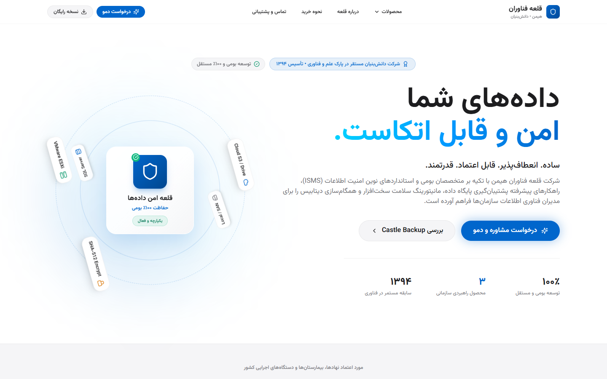

# Ghalee Corporate Website

Client project: the company website and admin panel of an enterprise data-protection software vendor.



## Overview

A website I built for a client, Ghalee Fanavaran Himen, a company that builds backup and hardware-monitoring software for organizations. It is the public face of the company and presents three products, each on its own page with an animated, interactive explanation of what the product does.

Behind it sits an admin panel where the team reviews quotation requests, edits site content and settings, and inspects an audit log of every administrative action.

## Features

- **Castle Backup story.** A scroll-driven walkthrough of how live backup protects an organization's data.
- **System diagnostics visualizer.** An animated view of hardware monitoring for the Professional System Information product.
- **SQL compare visualizer.** A side-by-side demonstration of how SQL Data Compare finds differences between databases.
- **Quotation requests.** A purchase form that records each request, which staff then track by status in the panel.
- **Editable content.** Page content and site settings are stored in the database and changed from the admin panel.
- **Search-engine ready.** Generated sitemap and robots file, per-page metadata, and privacy and terms pages.

## Engineering notes

- **Custom animated components.** Each product has a hand-built visualizer in React and Framer Motion instead of a stock screenshot.
- **Token-based admin authentication.** Signed tokens with jose and bcrypt password hashing, with login, logout and session endpoints.
- **Every admin action is audited.** A dedicated audit-log model records who did what, viewable from the panel.
- **Two ways to deploy.** A Dockerfile and docker-compose for a classic server, and an OpenNext build for Cloudflare.
- **Mobile-first conversion.** A sticky call-to-action on small screens and a consent-aware cookie banner.

## Architecture

| Layer | What it does |
| --- | --- |
| Pages | Home, about, three product pages, purchase, contact, legal |
| Admin | Dashboard, quotations, settings, audit logs |
| API routes | Contact, admin auth, quotations, settings, stats, audit logs |
| Prisma + MySQL | Users, products, page content, site settings, submissions, audit log |

## Tech stack

- **Frontend:** Next.js 14 App Router, React 18, TypeScript, Tailwind CSS, Framer Motion
- **Backend:** Route handlers, jose, bcrypt
- **Data:** Prisma, MySQL
- **Deployment:** Docker, Cloudflare via OpenNext

## Run locally

Requires Node.js 20+ and MySQL.

```bash
npm install
```

Copy `.env.example` to `.env` and fill in your own values, then:

```bash
npm run db:push
```

```bash
npm run db:seed
```

```bash
npm run dev
```

## Author

Built by Amin.
